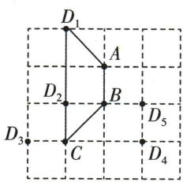
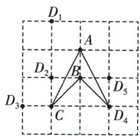
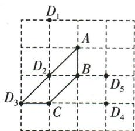
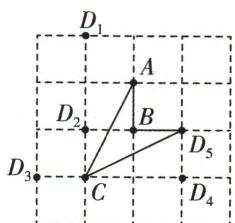
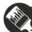

> [!success]- 必刷题
>
> > [!success] **【答案】** C
>
> > [!note]- **【解析】**
> > 只有第四个图案中的图形沿某条直线折叠后直线两旁的部分能够完全重合, 是轴对称图形, 所以不是利用轴对称设计的图案有 3 个. 故选 C.
> >
> > 2.4 【解析】如图, $D_{1},D_{3},D_{4},D_{5}$ 四点满足题意,故答案为4.
> >
> > 
> >
> > 
> >
> > 
> >
> > 
> >
> > 思路分析
> > (1) 利用网格特点, 分别画出 A, B, C 关于直线 MN 的对称点 $A_{1}$ , $B_{1}, C_{1}$ 即可.
> > (2)由于PA= $PA_{1}$ ，则 $|PB-PA|=|PB-PA_{1}|$ ，而 $|PB-PA_{1}|\leqslant A_{1}B$ ，当点P， $A_{1}$ ，B共线时取等号，从而得到 $|PB-PA|$ 的最大值.
> >
> > 思路分析6.【解】(1)如图, $\triangle A_{1}B_{1}C_{1}$ 即为所作.
> >
> > 
> >
> > 思路分析
> > 根据坐标的特点,判定点 A 在 y 轴上, C, D 关于 y 轴对称, 结合正五边形是轴对称图形, 得到 B, E 关于 y 轴对称, 即可得到答案.
