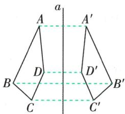
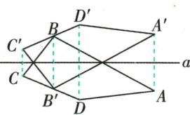
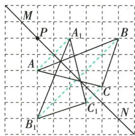

> [!success]- 必刷题
>
> > [!success] **【答案】** 详见解析
>
> > [!note]- **【解析】**
> > 【解】如图(1)、(2)，四边形 $A^{\prime}B^{\prime}C^{\prime}D^{\prime}$ 即为所求.
> >
> > 
> > 图(1)
> >
> > 
> > 图(2)
> >
> > (2)如图,点 P 即为所求, $|PB-PA|$ 的最大值为 3.
> >
> > 
> > 课时2 轴对称与坐标变化
