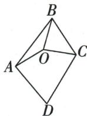
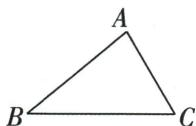

<!-- question-source:start -->
2[2024 天津和平区期中]如图, 已知 O 是四边形 ABCD 内一点, OA = OB = OC, $\angle ABC = \angle ADC = 70^{\circ}$ , 则 $\angle DAO + \angle DCO$ 的大小是 ( )
A. $70^{\circ}$ B. $110^{\circ}$ C. $140^{\circ}$ D. $150^{\circ}$

(第2题图)

(第3题图)
<!-- question-source:end -->

![[Q00104256A1]]
