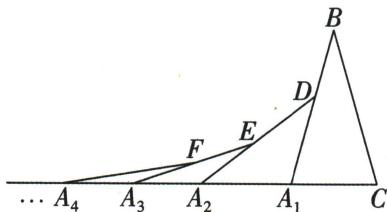

<!-- question-source:start -->
4 如图, 在第一个三角形 $A_{1}BC$ 中, $\angle B = 30^{\circ}$ , $A_{1}B = CB$ , 在边 $A_{1}B$ 上任取一点 $D$ , 延长 $CA_{1}$ 到 $A_{2}$ , 使 $A_{1}A_{2} = A_{1}D$ , 得到第二个三角形 $A_{1}A_{2}D$ , 在边 $A_{2}D$ 上任取一点 $E$ , 延长 $A_{1}A_{2}$ 到 $A_{3}$ , 使 $A_{2}A_{3} = A_{2}E$ , 得到第三个三角形 $A_{2}A_{3}E, \cdots$ , 按此作法继续下去, 第 $n$ 个等腰三角形的底角的度数是 \_\_\_\_°. ( $n$ 为正整数)

建议用时 15 分钟
<!-- question-source:end -->

![[Q00104258A1]]
