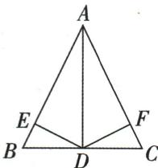
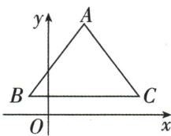
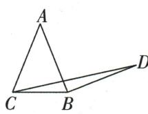

<!-- question-source:start -->
5 如图, 在 $\triangle ABC$ 中, $AB = AC$ , $AD \perp BC$ 于点 $D$ , $DE \perp AB$ 于点 $E$ , $DF \perp AC$ 于点 $F$ , 下列结论: ① $\angle BAD = \angle CAD$ ; ② $AD$ 上任意一点到 $AB$ , $AC$ 的距离相等; ③ $BD = CD$ ; ④ 若点 $P$ 在直线 $AD$ 上, 则 $PB = PC$ . 其中正确的是 ( )
A. ① B. ①② C. ①②③ D. ①②③④

(第5题图)
(第6题图)

(第7题图)
<!-- question-source:end -->

![[Q00104259A1]]
