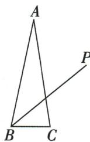

<!-- question-source:start -->
8 如图, $\triangle ABC$ 是等腰三角形, $AB = AC$ , $\angle A = 20^{\circ}$ , $BP$ 平分 $\angle ABC$ , 点 $D$ 是射线 $BP$ 上一点, 如果点 $D$ 满足 $\triangle BCD$ 是等腰三角形, 那么 $\angle BDC$ 的度数是 \_\_\_\_.

<!-- question-source:end -->

![[Q00104262A1]]
