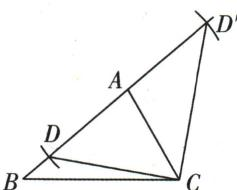

> [!success]- 必刷题
>
> > [!success] **【答案】** C
>
> > [!note]- **【解析】**
> > 如图. 在 $\triangle ABC$ 中, $\angle ABC = 40^{\circ}$ , $\angle BAC = 80^{\circ}$ , $\therefore \angle ACB = 180^{\circ} - 40^{\circ} - 80^{\circ} = 60^{\circ}$ .
> >
> > 
> > - **①**：由作图可知 $AC = AD, \therefore \angle ACD = \angle ADC = \frac{1}{2} \times (180^{\circ} - 80^{\circ}) = 50^{\circ}, \therefore \angle BCD = \angle ACB - \angle ACD = 60^{\circ} - 50^{\circ} = 10^{\circ};$ ②由作图可知 $AC = AD', \therefore \angle ACD' = \angle AD'C. \because \angle ACD' + \angle AD'C = \angle BAC = 80^{\circ}, \therefore \angle AD'C = 40^{\circ}, \therefore \angle BCD' = 180^{\circ} - \angle ABC - \angle AD'C = 180^{\circ} - 40^{\circ} - 40^{\circ} = 100^{\circ}.$ 综上所述， $\angle BCD$ 的度数是 $10^{\circ}$ 或 $100^{\circ}.$ 故选 C.
> >
> > 思路分析
> > 作 $AE \perp BC$ 于 E, $DF \perp CB$ 交 CB 的延长线于 F, 根据等腰三角形三线合一的性质, 得出 $CE = BE = \frac{1}{2} BC$ , 证明 $\triangle ABE \cong \triangle BDF$ , 得出 DF = EB, 即可求出 $\triangle BCD$ 的面积.
