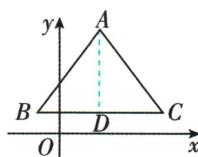

> [!success]- 必刷题
>
> > [!success] **【答案】** C
>
> > [!note]- **【解析】**
> > 过点 A 作 $AD \perp BC$ 于 D，如图. ∵ AB = AC, $AD \perp BC$ , ∴ BD = CD. ∵ 点 $A(2,5)$ , $B(-1,1)$ , $BC \parallel x$
> >
> > 
> >
> > 轴，∴点 $D(2,1)$ . 设点 $C(m,1)$ ，则 CD=m-2. ∵ BD=2-(-1)=3, ∴ m-2=3, ∴ m=5, ∴ 点 C 的坐标为 (5,1)，
> >
> > 故选 **C**.
