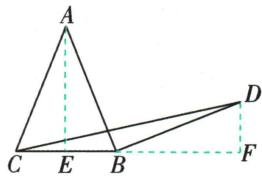

> [!success]- 必刷题
>
> > [!success] **【答案】** 9
>
> > [!note]- **【解析】**
> > 如图, 作 $AE \perp BC$ 于 $E$ , 作 $DF \perp CB$ 交 $CB$ 的延长线于 $F$ . $\because AB = AC, BC = 6$ ,
> >
> > 
> >
> > $\therefore CE = BE = \frac{1}{2} BC = 3.\because \angle ABD = 90^{\circ},DF\perp CB,\therefore \angle ABC + \angle DBF = \angle BDF + \angle DBF,$ $\therefore \angle ABC = \angle BDF.\because AE\perp BC,\therefore \angle AEB =$ $\angle BFD = 90^{\circ}$ .在 $\triangle ABE$ 和 $\triangle BDF$ 中， $\left\{ \begin{array}{l}\angle ABC = \angle BDF,\\ \angle AEB = \angle BFD,\therefore \triangle ABE\cong \triangle BDF(AAS),\\ AB = BD, \end{array} \right.$ $\therefore DF = BE = 3,\therefore S_{\triangle BCD} = \frac{1}{2} BC\cdot DF = \frac{1}{2}\times 6\times$ $3 = 9.$ 故答案为9.
> >
> > ## 刷易错·
