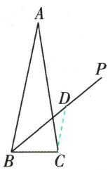
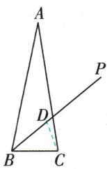
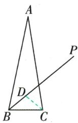

> [!success]- 必刷题
>
> > [!success] **【答案】** $40^{\circ}$ 或 $70^{\circ}$ 或 $100^{\circ}$
>
> > [!note]- **【解析】**
> > - **①**：当 BC = CD 时，如图（1）所示. ∵ $\angle A = 20^{\circ}$ , AB = AC, ∴ $\angle ABC = 80^{\circ}$ . ∵ BP 平分 $\angle ABC$ , ∴ $\angle CBD = 40^{\circ}$ . ∵ BC = CD, ∴ $\angle CBD = \angle BDC = 40^{\circ}$ . ②当 BD = BC 时，如图（2）所示. 由①可知 $\angle CBD = 40^{\circ}$ . ∵ BD = BC, ∴ $\angle BDC = 70^{\circ}$ . ③当 DB = DC时,如图(3)所示. 由①可知 $\angle CBD = 40^{\circ}$ . $\because BD = CD, \therefore \angle BDC = 100^{\circ}$ . 故答案为 $40^{\circ}$ 或 $70^{\circ}$ 或 $100^{\circ}$ .
> >
> > 
> > 图(1)
> >
> > 
> >
> > 
> > 图(2)
> > 图(3)
> > 课时 2 等腰三角形的判定
