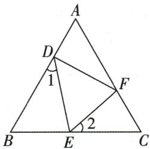

<!-- question-source:start -->
3[2025 辽宁大连期中]如图, $\triangle ABC$ 是等边三角形,点D,E,F分别在AB,BC,AC上, $\angle1=\angle2$ , $\angle DFE=70^{\circ}$ ,则 $\angle EDF=$ \_\_\_\_°.

<!-- question-source:end -->

![[Q00104277A1]]
