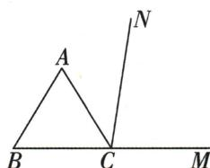

<!-- question-source:start -->
4[2025 福建南平期中]如图, CN 是等边 $\triangle ABC$ 的外角 $\angle ACM$ 内部的一条射线, 点 A 关于 CN 的对称点为 D, 连接 BD, CD.

(1)依题意补全图形(尺规作图,保留作图痕迹,不写作法);

(2) 若 $\angle ACN = 40^{\circ}$ , 求 $\angle BDC$ 的度数.

<!-- question-source:end -->

![[Q00104278A1]]
