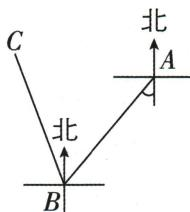

<!-- question-source:start -->
6 如图,一艘轮船由海平面上 A 地出发,向南偏西 $40^{\circ}$ 的方向行驶 80 海里到达 B 地,再由 B 地向北偏西 $20^{\circ}$ 的方向行驶 80 海里到达 C 地,则 A,C 两地相距
A.100 海里 B.80 海里
C.60 海里 D.40 海里

<!-- question-source:end -->

![[Q00104280A1]]
