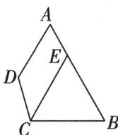

<!-- question-source:start -->
8[2024吉林松原期中]如图, $\triangle ECB$ 中, $\angle CEB=\angle B$ ,延长BE至点A,过点A作AD//CE, $\angle A=60^{\circ}$ ,连接CD.

求证: $\triangle ECB$ 是等边三角形.

<!-- question-source:end -->

![[Q00104282A1]]
