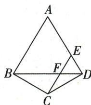

<!-- question-source:start -->
9[2025 吉林长春期中]如图,在四边形 ABCD 中,AB=AD,CB=CD, $\angle A=60^{\circ}$ ,点 E 为 AD 上一点,连接 BD,CE 交于点 F,CE//AB.

(1) 判断 $\triangle DEF$ 的形状, 并说明理由;

(2) 若 AD=13, CE=9, 则 CF 的长为 \_\_\_\_.

<!-- question-source:end -->

![[Q00104283A1]]
