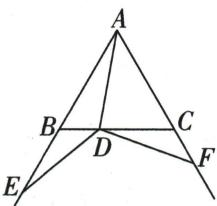
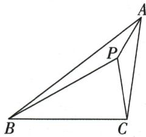

<!-- question-source:start -->
1[2024 浙江金华期中, 中]如图所示, 边长为 2 的等边三角形 ABC 中, D 点在边 BC 上运动 (不与 B, C 重合), 点 E 在边 AB 的延长线上, 点 F 在边 AC 的延长线上, AD = DE = DF. 点 D 在 BC 边上从 B 至 C 的运动过程中, $\triangle BED$ 周长的变化规律为
A. 不变    B. 一直变小
C. 先变大后变小    D. 先变小后变大

(第1题图)

(第2题图)
<!-- question-source:end -->

![[Q00104284A1]]
