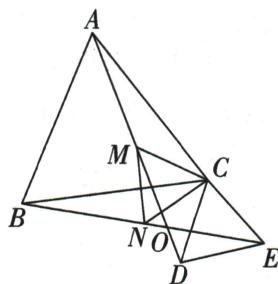

<!-- question-source:start -->
3[较难]已知:如图, $\triangle ABC$ , $\triangle CDE$ 都是等边三角形,AD,BE相交于点O,点M,N分别是线段AD,BE的中点.

(1) 求证: AD = BE;

(2) 求 $\angle DOE$ 的度数;

(3) 求证: $\triangle MNC$ 是等边三角形.

<!-- question-source:end -->

![[Q00104286A1]]
