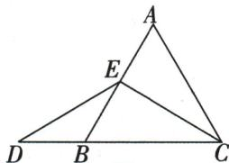
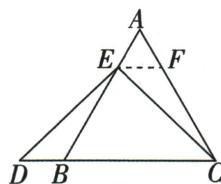

<!-- question-source:start -->
4 核心素养推理能力 [难] 已知在等边三角形 $ABC$ 中, 点 $E$ 在 $AB$ 上, 点 $D$ 在 $CB$ 的延长线上, 且 $ED = EC$ .

(1)【特殊情况,探索结论】
如图(1),当点E为AB的中点时,确定线段AE与DB的大小关系,请你直接写出结论:AE \_\_\_\_ DB(填“>”“<”或“=”).

(2)【特例启发,解答题目】
如图(2),当点E为AB边上任意一点时,确定线段AE与DB的大小关系,请你直接写出结论:AE \_\_\_\_ DB(填“>”“<”或“=”).
理由如下:过点E作EF//BC,交AC于点F.
(请你完成解答过程).

(3)【拓展结论,设计新题】
在等边三角形 ABC 中, 点 E 在直线 AB 上, 点 D 在线段 CB 的延长线上, 且 ED = EC, 若 $\triangle ABC$ 的边长为 1, AE = 2, 求 CD 的长 (请你画出相应图形, 并直接写出结果).

图(1)

图(2)
<!-- question-source:end -->

![[Q00104287A1]]
