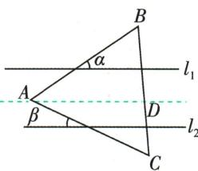

> [!success]- 必刷题
>
> > [!success] **【答案】** C
>
> > [!note]- **【解析】**
> > 如图, 过点 A 作 $AD \parallel l_{1}$ , 则 $\angle BAD = \angle \alpha = 35^{\circ}$ . $\because l_{1} \parallel l_{2}$ , $\therefore AD \parallel l_{2}$ , $\therefore \angle DAC = \angle \beta$ . $\because \triangle ABC$ 是等边三
> >
> > 
> >
> > 角形, $\therefore \angle BAC = 60^{\circ}, \therefore \angle \beta = \angle DAC = \angle BAC - \text{一题多解} \angle DAB = 60^{\circ} - 35^{\circ} = 25^{\circ}$ .
> >
> > 故选 **C**. 延长 $BA$ 与 $l_{2}$
