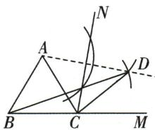

> [!success]- 必刷题
>
> > [!success] **【答案】** A
>
> > [!note]- **【解析】**
> > 【解】(1)如图所示.
> >
> > 
> >
> > (2)∵A,D关于CN对称,∴CN垂直平分AD,
> > ∴AC=CD,∴∠ACN=∠NCD=40°.∵△ABC
> > 是等边三角形,∴∠ACB=60°,AC=BC,
> > ∴∠BCD=∠BCA+∠ACN+∠NCD=60°+2×
> > 40°=140°,BC=CD,∴∠CBD=∠CDB,
> > ∴∠BDC= $\frac{180^{\circ}-140^{\circ}}{2}$ =20°.
