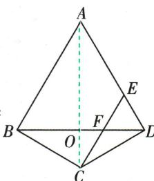

> [!success]- 必刷题
>
> > [!success] **【答案】** 5
>
> > [!note]- **【解析】**
> > 【解】(1) $\triangle DEF$ 是等边三角形. 理由如下: $\because AB = AD, \angle A = 60^{\circ}, \therefore \triangle ABD$ 为等边三角形, $\therefore \angle ADB = \angle ABD = 60^{\circ}$ . $\because CE \parallel AB$ , $\therefore \angle DEF = \angle A = 60^{\circ}, \angle EFD = \angle ABD = 60^{\circ}$ , $\therefore \angle EFD = \angle EDF = \angle DEF$ , $\therefore \triangle DEF$ 是等边三角形.
> >
> > (2) 连接 AC 交 BD 于点 O, 如图. ∵ AB = AD, CB = CD, ∴ AC 垂直平分 BD, ∴ AC 平分 ∠BAD, ∴ ∠BAO = ∠DAO. ∵ CE // AB, ∴ ∠ACE = ∠BAO =
> >
> > 
> >
> > $\angle DAO, \therefore AE=CE=9, \therefore DE=AD-AE=13-9=4.$ ∵ $\triangle DEF$ 是等边三角形, ∴ EF=DE=4, ∴ CF=CE-EF=9-4=5. 故答案为 5.
