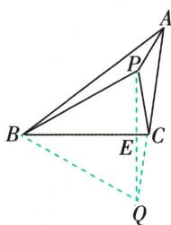

> [!success]- 必刷题
>
> > [!success] **【答案】** 142
>
> > [!note]- **【解析】**
> > 延长 $AC$ 到 $Q$ , 使 $AQ = AB$ , 连接 $PQ, BQ, PQ$ 交 $BC$ 于点 $E$ , 如图. $\because \angle PBA = 8^{\circ}, \angle APB = 150^{\circ}, \therefore \angle BAP = 180^{\circ} - (\angle PBA + \angle APB) = 22^{\circ}$ .
> >
> > 
> >
> > $\because \angle CAP = 22^{\circ}, \therefore \angle CAP = \angle BAP = 22^{\circ}$ . 在 $\triangle QAP$ 和 $\triangle BAP$ 中， $\left\{ \begin{array}{l} AQ = AB, \\ \angle QAP = \angle BAP, \\ AP = AP, \end{array} \right.$ $\therefore \triangle QAP \cong \triangle BAP(SAS), \therefore \angle APQ = \angle APB = 150^{\circ}, \angle PQA = \angle PBA = 8^{\circ}, PQ = PB, \therefore \angle BPQ = 360^{\circ} - (\angle APQ + \angle APB) = 60^{\circ}, \therefore \triangle PBQ$ 是等边三角形， $\therefore \angle PBQ = \angle BPQ = 60^{\circ}. \because \angle PBC = 30^{\circ}, \therefore \angle QBC = \angle PBQ - \angle PBC = 30^{\circ}, \therefore \angle QBC = \angle PBC = 30^{\circ}, \therefore BC$ 是 $\angle PBQ$ 的平分线， $\therefore BC \perp PQ, PE = QE, \therefore BC$ 是线段 $PQ$ 的垂直平分线， $\therefore PC = QC, \therefore \angle CPQ = \angle PQA = 8^{\circ}, \therefore \angle BPC = \angle BPQ + \angle CPQ = 68^{\circ}, \therefore \angle APC = 360^{\circ} - (\angle APB + \angle BPC) = 360^{\circ} - (150^{\circ} + 68^{\circ}) = 142^{\circ}$ . 故答案为 142.
