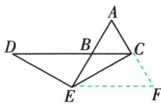

> [!success]- 必刷题
>
> > [!success] **【答案】** =
>
> > [!note]- **【解析】**
> > (1) =
> > 【解】(2) AE = DB. 理由如下: 过点 E 作 EF // BC, 交 AC 于点 F. ∵ △ABC 为等边三角形,
> > ∴ ∠ABC = ∠ACB = 60°. ∵ EF // BC, ∴ ∠AEF =
> > ∠AFE = 60°, ∴ △AEF 为等边三角形, ∴ AE =
> > EF = AF, ∴ BE = CF. ∵ ED = EC, ∴ ∠D =
> > ∠ECD. ∵ ∠DEB = ∠ABC - ∠D = 60° - ∠D,
> > ∠ECF = ∠ACB - ∠ECD = 60° - ∠ECD,
> > ∴ ∠DEB = ∠ECF.
> > 在△DBE 和△EFC 中, $\left\{\begin{aligned} DE &= EC, \\ \angle DEB &= \angle ECF, \\ BE &= FC, \end{aligned}\right.$ ∴ △DBE ≅ △EFC(SAS), ∴ DB = EF, 则 AE = DB. 故答案为 =.
> >
> > (3)根据题意画图,如图所示,CD=3.过点E作EF//BC,交AC延长线于点F.∵△ABC是等边三
> >
> > 
> >
> > 角形, $\therefore \angle ABC = \angle ACB = 60^{\circ}$ . $\because EF \parallel BC$ , $\therefore \angle AEF = \angle F = 60^{\circ}$ , $\therefore \triangle AEF$ 为等边三角形, $\therefore AE = EF = 2$ , 同 (2) 可证 $\triangle DBE \cong \triangle EFC$ , $\therefore DB = EF = 2$ , 则 $CD = BC + DB = 3$ .
