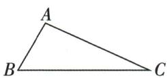
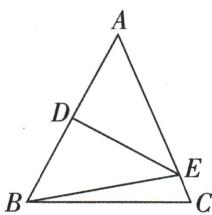

<!-- question-source:start -->
1[2025 黑龙江哈尔滨质检]A, B, C 三地之间想建立一个货物中转仓, 使其到三地的距离相等, 如图所示, 则中转仓的位置应选在 ( )

A. △ABC 三边中线的交点处

B. △ABC 三条角平分线的交点处

C. △ABC 三边垂直平分线的交点处

D. △ABC 三边高线的交点处

(第1题图)

(第2题图)
<!-- question-source:end -->

![[Q00104216A1]]
