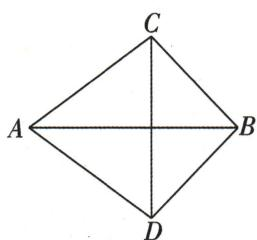
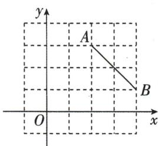

<!-- question-source:start -->
4[2024 辽宁丹东期末]如图, $AC = AD$ , $BC = BD$ , 则 ( )
A. $CD$ 垂直平分 $AB$ B. $AB$ 垂直平分 $CD$ C. $CD$ 平分 $\angle ACB$ D. 以上结论均不对

(第 4 题图)

(第 5 题图)
<!-- question-source:end -->

![[Q00104219A1]]
