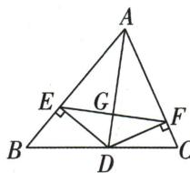

<!-- question-source:start -->
6[2024 山东淄博期末]如图,已知 $\triangle ABC, AD$ 是 $\angle BAC$ 的平分线, $DE \perp AB$ 于点 E, $DF \perp AC$ 于点 F, 连接 EF 交 AD 于点 G.

(1) 求证: AD 垂直平分 EF;

(2) 若 $AB + AC = 10, DE = 3$ , 求 $\triangle ABC$ 的面积.

<!-- question-source:end -->

![[Q00104221A1]]
