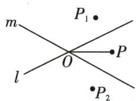
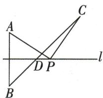

<!-- question-source:start -->
1[中]如图, 直线 l, m 相交于点 O, P 为这两直线外一点, 且 OP = 2.8. 若点 P 关于直线 l, m 对称的点分别是点 $P_{1}, P_{2}$ , 则 $P_{1}, P_{2}$ 之间的距离可能是
A.0 B.5 C.6 D.7

(第1题图)

(第2题图)
<!-- question-source:end -->

![[Q00104224A1]]
