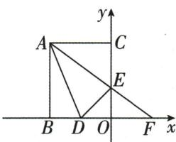
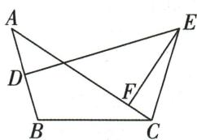

<!-- question-source:start -->
3[2025 湖南湘西州期中, 中]如图, 长方形 ABOC 的顶点 A 的坐标为 $(-4, 5)$ , D 是 OB 的中点, E 是 OC 上的一点, AE 的延长线交 x 轴于 F, 当 $\triangle ADE$ 的周长最小时, $\triangle ADF$ 的面积是 ( ) A. 6 B. 8 C. 10 D. 12

(第3题图)

(第 4 题图)
<!-- question-source:end -->

![[Q00104226A1]]
