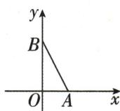

<!-- question-source:start -->
5[2024 广东广州期末, 中]如图, 在平面直角坐标系中, 点 A(4, 0), B(0, 8), 点 C 在 AB 的垂直平分线上, 且 $\angle ACB = 90^{\circ}$ , 则点 C 的坐标为 \_\_\_\_.

<!-- question-source:end -->

![[Q00104228A1]]
