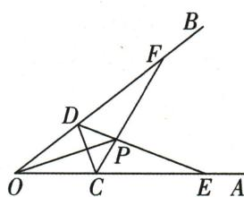

<!-- question-source:start -->
6[2025 河北邯郸质检, 中]如图, 点 P 在 $\angle AOB$ 的平分线上, 点 E, F 分别在 OA, OB 上, 且 $\angle OFP = \angle OEP$ .

(1) 求证: PF = PE.

(2)延长 $FP, EP$ , 分别交 $OA, OB$ 于点 $C, D$ , 连接 $CD$ , 若 $DP$ 平分 $\angle CDB$ , 回答下列问题:
①试说明 $CP$ 平分 $\angle ACD$ ;
②若 $CD = 2, S_{\triangle PCD} = 2$ , 求点 $P$ 到射线 $OA$ 的距离.

<!-- question-source:end -->

![[Q00104229A1]]
