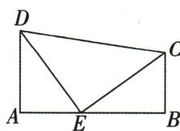

<!-- question-source:start -->
7 核心素养推理能力 [中] 如图, 在四边形 ABCD 中, $\angle A = \angle B = 90^{\circ}, AB = 25 \, cm, DA = 15 \, cm, CB = 10 \, cm.$ 动点 E 从 A 点出发, 以 2 cm/s 的速度向 B 点移动, 设移动的时间为 x s.

(1) 当 $x$ 为何值时, 点 $E$ 在线段 $CD$ 的垂直平分线上? 并说明理由.

(2) 在 (1) 的条件下, 判断 $DE$ 与 $CE$ 的位置关系, 并说明理由.

<!-- question-source:end -->

![[Q00104230A1]]
