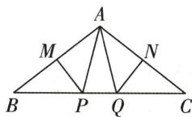
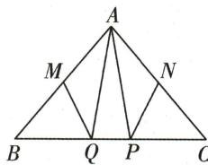

> [!success]- 必刷题
>
> > [!success] **【答案】** 10 或 14
>
> > [!note]- **【解析】**
> > 当点 P 在点 Q 的左侧时, 如图(1). 由线段垂直平分线的性质可得, AP = BP, AQ = QC, ∴ $\triangle AQP$ 的周长为 $AP + AQ + PQ = BP + QC + PQ = BC = 10$ .
> >
> > 
> >
> > 
> > 图(1)
> > 图(2)
> >
> > 当点 P 在点 Q 的右侧时, 如图(2). 由线段垂直平分线的性质可得, AP = BP, AQ = QC, $\therefore \triangle AQP$ 的周长为 $AP + AQ + PQ = BP + QC + PQ = BP + CP + PQ + PQ = BC + 2PQ = 10 + 4 = 14$ . 综上所述, $\triangle AQP$ 的周长为 10 或 14, 故答案为 10 或 14.
