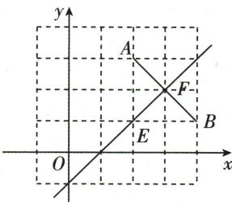

> [!success]- 必刷题
>
> > [!success] **【答案】** $(1,0)$ 或 $(0,-1)$
>
> > [!note]- **【解析】**
> > 如图,取格点 E(2,
> >
> > 1), $F(3,2)$ ，作直线 EF，则点 F 为 AB 的中点，AE = BE = 2，∴ AF = BF，∴ 点 E, F 都在线段 AB 的垂直平分
> >
> > 
> >
> > 线上，∴ 直线 EF 是线段 AB 的垂直平分线. 根据图易得直线 EF 与 x 轴交于点 $(1,0)$ ，与 y 轴交于点 $(0,-1)$ . ∵ 点 P 到点 A 和点 B 的距离相等，∴ 点 P 在线段 AB 的垂直平分线 EF 上，∴ 点 P 的坐标为 $(1,0)$ 或 $(0,-1)$ ，故答案为 $(1,0)$ 或 $(0,-1)$ .
