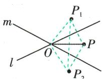

> [!success]- 必刷题
>
> > [!success] **【答案】** B
>
> > [!note]- **【解析】**
> > 如图, 连接 $OP_{1}, OP_{2}, P_{1}P_{2}, PP_{1}, PP_{2}$ . ∵ 点 P 关于直线 l, m 的对称点分别是点 $P_{1}, P_{2}, \therefore$ 直线 l 垂直平分 $PP_{1}$ , 直线 m 垂直平分 $PP_{2}, \therefore OP_{1} = OP = OP_{2} = 2.8$ . 根据三角形三边关系定理可知 $OP_{1} - OP_{2} < P_{1}P_{2} < OP_{1} + OP_{2}$ , 即 $0 < P_{1}P_{2} < 5.6$ , 故选 B.
> >
> > 思路分析
> > 利用线段垂直平分线的性质可得 AP = BP，
> > 进而可得 $AP + PC = BP + PC$ 再根据三角形三边关系及 P 点位置即可确定结论.
> >
> > 
> >
> > 思路分析
> > 连接 AE, BE,
> > 过点 E 作 $EG \perp BC$ 交 BC
> > 的延长线于点
> > G, 根据角平
> > 分线的性质以
> > 及垂直平分线
> > 的性质得出
> > EF = EG, AE =
> > BE, 进而判定
> > Rt $\triangle EFC \cong$ Rt $\triangle EGC$ ,
> > Rt $\triangle AEF \cong$ Rt $\triangle BEG$ , 即
> > 可得到 CF =
> > CG, AF = BG,
> > 据此列出方
> > 程, 解方程即
> > 可得到 AF 的
> > 长.
