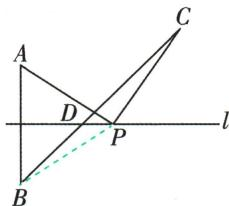
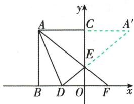

> [!success]- 必刷题
>
> > [!success] **【答案】** B
>
> > [!note]- **【解析】**
> > 如图, 连接 $BP$ . $\because$ 直线 $l$ 是线段 $AB$ 的垂直平分线, $\therefore AP = BP$ , $\therefore AP + PC = BP + PC$ . $\because$ 点 $P$ 不与点 $D$ 重合, $\therefore AP + PC = BP + PC > BC$ . 故选 B.
> >
> > 
> > (第2题图)
> >
> > 
> > (第3题图)
