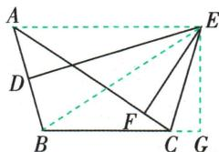

> [!success]- 必刷题
>
> > [!success] **【答案】** C
>
> > [!note]- **【解析】**
> > ∵ 长方形 ABOC 的顶点 A 的坐标为 $(-4,5)$ ，D 是 OB 的中点，∴ $AB \perp BO$ ， $OC \perp AC$ ，∴ AB = 5，OB = 4，∴ $OD = \frac{1}{2}OB = 2$ 。如图，作点 A 关于 y 轴的对称点 $A'$ ，连接 $A'E$ 。由轴对称的性质可得 $A'C = AC$ 。∵ $OC \perp AC$ ，∴ CO 垂直平分 $AA'$ ，∴ $AE = A'E$ ，∴ $\triangle ADE$ 的周长 = $AD + AE + DE = AD + A'E + DE$ ，∴ 当 $A', E, D$ 三点在同一条直线上时， $A'E + DE$ 的值最小，即 $\triangle ADE$ 的周长最小，易得此时 OF = OD = 2，∴ $DF = OD + OF = 4$ ，∴ $\triangle ADF$ 的面积是 $\frac{1}{2}DF \cdot AB = \frac{1}{2} \times 4 \times 5 = 10$ ，故选 C。
> >
> > 4.5 【解析】如图, 连接 AE, BE, 过点 E 作 EG⊥
> >
> > 4.5 【解析】如图,连接 AE BC 交 BC 的延长线于点 G. ∵ D 是 AB 的中点, DE ⊥ AB, ∴ DE 垂直平分线段 AB, ∴ AE = BE.
> >
> > 
> >
> > $\because \angle ACE + \angle BCE = 180^{\circ}, \angle ECG + \angle BCE = 180^{\circ}, \therefore \angle ACE = \angle ECG, \therefore CE$ 是 $\angle ACG$ 的平分线. $\because EF \perp AC, EG \perp BC, \therefore EF = EG.$ 又 $\because CE = CE, \therefore Rt\triangle EFC \cong Rt\triangle EGC(HL), \therefore CF = CG.$ 在 Rt△AEF 和 Rt△BEG 中， $\left\{ \begin{array}{l} EA = EB, \\ EF = EG, \end{array} \right.$ $\therefore Rt\triangle AEF \cong Rt\triangle BEG(HL), \therefore AF = BG.$ 设 $CF = CG = x$ ，则 $AF = AC - CF = 6 - x, BG = BC + CG = 4 + x, \therefore 6 - x = 4 + x,$ 解得 $x = 1, \therefore AF = 6 - 1 = 5.$
