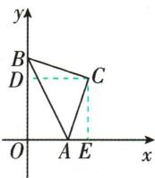
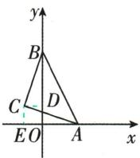

> [!success]- 必刷题
>
> > [!success] **【答案】** (6,6)或(-2,2)
>
> > [!note]- **【解析】**
> > 分两种情况:(1)如图(1)所示,过点C作 $CD \perp OB$ 于D, $CE \perp x$ 轴于E.∵ $\angle BCA = \angle DCE = 90^{\circ}$ ,∴ $\angle BCD = \angle ACE = 90^{\circ} - \angle ACD$ .∵点C在AB的垂直平分线上,∴BC=AC.在△BCD与△ACE中, $\left\{ \begin{array}{l} \angle BDC = \angle AEC = 90^{\circ}, \\ \angle BCD = \angle ACE, \\ BC = AC, \end{array} \right.$ $\therefore \triangle BCD \cong \triangle ACE$ (AAS), $\therefore AE = BD, CE = CD = OE. \because OA = 4, OB = 8, \therefore 4 + AE = 8 - AE, \therefore AE = 2, \therefore OE = OD = 6,$ 则点 $C$ 坐标为(6,6).
> >
> > 
> > 图(1)
> >
> > 
> > 图(2)
> >
> > 如图(2)所示,过点C作 $CD\perp OB$ 于D, $CE\perp x$ 轴于E.∵ $\angle BCA=\angle DCE=90^{\circ},\therefore\angle BCD=\angle ACE=90^{\circ}-\angle ACD.$ ∵点C在AB的垂直平分线上,∴BC=AC.在 $\triangle BCD$ 与 $\triangle ACE$ 中, $\left\{\begin{aligned}\angle BDC&=\angle AEC=90^{\circ},\\\angle BCD&=\angle ACE,\\ BC&=AC,\end{aligned}\right.$ $\therefore\triangle BCD\cong\triangle ACE$ (AAS), $\therefore AE=BD,CE=CD=OE,\therefore4+OE=8-OE,\therefore OE=2$ ,则点C坐标为(-2,2).综上可知点C坐标为(6,6)或(-2,2).故答案为(6,6)或(-2,2).
