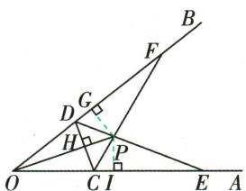

> [!success]- 必刷题
>
> > [!success] **【答案】** (1)
>
> > [!note]- **【解析】**
> > 【证明】∵点P在∠AOB的平分线上，
> > ∴ $\angle EOP = \angle FOP$ . 又∵ $\angle OFP = \angle OEP, OP = OP, \therefore \triangle OFP \cong \triangle OEP(AAS), \therefore PF = PE.$
> >
> > 思路分析
> > (2)根据全等三角形的性质得出 $\angle ADE = \angle CEB$ ，由 $\angle A = 90^{\circ}$ 得 $\angle AED + \angle CEB = 90^{\circ}$ ，进而可推出 $\angle DEC = 90^{\circ}$ ，即可得到结论.
> >
> > (2)【解】①如图,过点 P 作 OA, OB, CD 的垂线,垂足分别为 I, G, H.
> >
> > 
> >
> > ∵ 点 P 在 $\angle AOB$ 的平分线上, ∴ PG = PI.
> > ∵ DP 平分 $\angle CDB$ , ∴ PG = PH, ∴ PH = PI,
> > ∴ CP 平分 $\angle ACD$ .
> > - **②**：由（1）得 $\triangle OFP \cong \triangle OEP, \therefore OF = OE.$ 又 $\because \angle OFC = \angle OED, \angle FOC = \angle EOD, \therefore \triangle FOC \cong \triangle EOD(\mathrm{ASA}), \therefore OD = OC, DE = CF.$ $\because PF = PE, \therefore PD = PC, \therefore OP$ 是线段 $CD$ 的垂直平分线，则点 $H$ 是 $OP$ 与 $CD$ 的交点. $\because CD = 2, S_{\triangle PCD} = 2, \therefore \frac{1}{2} \times CD \times PH = 2, \therefore PH = 2, \therefore PH = PI = 2$ ，即点 $P$ 到射线 $OA$ 的距离为 2.
> >
> > ## 刷素养·
