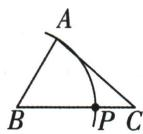
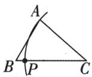
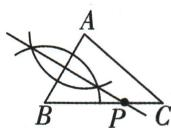
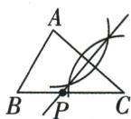

<!-- question-source:start -->
1[2025 福建厦门期中] $\triangle ABC$ 中, $AB < AC < BC$ , 如果要用尺规作图的方法在 $BC$ 上确定一点 $P$ , 使 $PA + PB = BC$ , 那么符合要求的作图痕迹是 ( )

A

B

C

D
<!-- question-source:end -->

![[Q00104231A1]]
