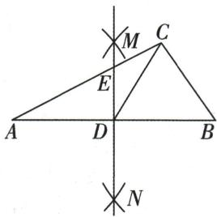

<!-- question-source:start -->
2[2025 山西大同期末]如图,在 $\triangle ABC$ 中,分别以点 $A$ 和点 $B$ 为圆心,以相同的长 $\left(\text{大于}\frac{1}{2}AB\right)$ 为半径作弧,两弧相交于点 $M$ 和点 $N$ ,作直线 $MN$ 交 $AB$ 于点 $D$ ,交 $AC$ 于点 $E$ ,连接 $CD$ .若 $\triangle CDB$ 的面积为24, $\triangle ADE$ 的面积为18,则四边形 $EDBC$ 的面积为\_\_\_\_.

<!-- question-source:end -->

![[Q00104232A1]]
