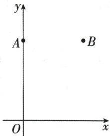

<!-- question-source:start -->
3[2024 福建莆田期中]如图,在平面直角坐标系 $xOy$ 中,点 $A(0,8)$ ,点 $B(6,8)$ .

(1) 尺规作图: 在第一象限内求作一个点 P, 使点 P 同时满足下列两个条件 (要求保留作图痕迹, 不必写出作法).

①点 P 到 A, B 两点的距离相等;

②点 $P$ 到两坐标轴的距离相等.

(2)(1)中点P的坐标为\_\_\_\_.
<!-- question-source:end -->

![[Q00104233A1]]
