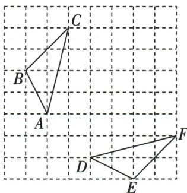
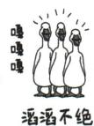

<!-- question-source:start -->
4 如图, 网格中的 $\triangle ABC$ 与 $\triangle DEF$ 为轴对称图形.

(1) 利用网格线作出 $\triangle ABC$ 与 $\triangle DEF$ 的对称轴 $l$ .

(2) 若每一个小正方形的边长为 1, 则 $\triangle ABC$ 的面积为 \_\_\_\_.

(3) 找出顶点在格点, 以 BC 为一边且与 $\triangle ABC$ 全等 (不与 $\triangle ABC$ 重合) 的三角形, 这样的三角形在网格内共能画出 \_\_\_\_ 个.

<!-- question-source:end -->

![[Q00104234A1]]
