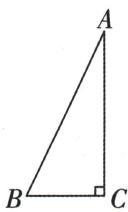

<!-- question-source:start -->
5[2025 重庆渝中区质检]如图, Rt $\triangle ACB$ 中, $\angle ACB = 90^{\circ}$ .

请在 AC 边上截取线段 CD, 使得 CD = BC, 过点 D 作直线 AB 的垂线, 垂足为点 E, 交 BC 的延长线于点 F. (尺规作图, 保留作图痕迹, 不写作法)
<!-- question-source:end -->

![[Q00104235A1]]
