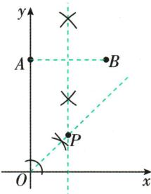
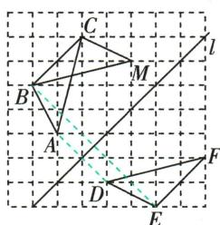

> [!success]- 必刷题
>
> > [!success] **【答案】** (3,3)
>
> > [!note]- **【解析】**
> > 【解】(1)如图,点P即为所求.
> >
> > 
> >
> > (2)∵点A(0,8)，点B(6,8)，∴线段AB中点坐标为(3,8)，∴点P横坐标为3.∵点P到两坐标轴的距离相等，点P在第一象限，∴P(3,3).故答案为(3,3).
> >
> > ## 关键点拨
> >
> > (2) 用一个长◀4.【解】(1) 如图, 直线 l 即为所作.
> >
> > 方形的面积减去三个直角三角形的面积可得 $\triangle ABC$ 的面积.
> >
> > 
> > E
> >
> > (2) $\triangle ABC$ 的面积为 $2 \times 4 - \frac{1}{2} \times 2 \times 1 - \frac{1}{2} \times 4 \times 1 - \frac{1}{2} \times 2 \times 2 = 3$ . 故答案为 3.
> >
> > (3) 如图, $\triangle MBC$ 即为以 $BC$ 为一边且与 $\triangle ABC$ 全等 (不与 $\triangle ABC$ 重合) 的三角形, 这样的三角形在网格内能画 1 个. 故答案为 1.
