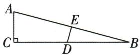
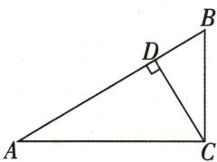

<!-- question-source:start -->
1[2024 河南信阳期中]如图, 在 $\triangle ABC$ 中, $\angle C = 90^{\circ}, \angle B = 15^{\circ}$ , $AB$ 的垂直平分线交 $BC$ 于点 $D$ , 交 $AB$ 于点 $E$ . 若 $DB = 12 \mathrm{~cm}$ , 则 $AC =$ ( ) A. $4 \mathrm{~cm}$ B. $5 \mathrm{~cm}$ C. $6 \mathrm{~cm}$ D. $7 \mathrm{~cm}$

(第1题图)

(第2题图)
<!-- question-source:end -->

![[Q00104288A1]]
