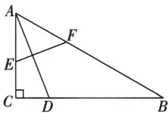
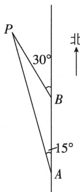

<!-- question-source:start -->
3[2024 北京西城区期末]如图, Rt△ABC 中, ∠ACB=90°, ∠B=30°, AC=2. D 为 BC 上一动点, 连接 AD, AD 的垂直平分线分别交 AC, AB 于点 E, F, 则线段 BF 长的最大值是 ( )
A. $\frac{1}{2}$ B. $\frac{4}{3}$ C. $\frac{8}{3}$ D.4

(第3题图)

(第 4 题图)
<!-- question-source:end -->

![[Q00104290A1]]
