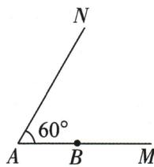
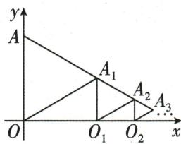

<!-- question-source:start -->
5 如图, $\angle MAN = 60^{\circ}$ , 点 $B$ 在射线 $AM$ 上, 且 $AB = 2$ , 点 $C$ 在射线 $AN$ 上. 若 $\triangle ABC$ 是锐角三角形, 则 $AC$ 的取值范围是 \_\_\_\_.

(第5题图)
(第6题图)
<!-- question-source:end -->

![[Q00104292A1]]
