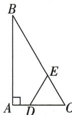

<!-- question-source:start -->
7[2024江西南昌期中]如图,在 $\triangle ABC$ 中, $\angle A=90^{\circ},\angle B=30^{\circ},AC=6cm$ ,点D从点A出发以1cm/s的速度向点C运动,同时点E从点C出发以2cm/s的速度向点B运动,运动的时间为t s,解决以下问题:

(1) 当 t 为何值时, $\triangle DEC$ 为等边三角形?
(2) 当 t 为何值时, $\triangle DEC$ 为直角三角形?

电子错题本鸭
<!-- question-source:end -->

![[Q00104294A1]]
