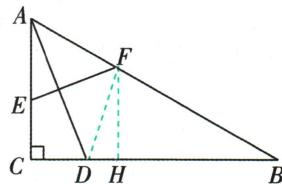

> [!success]- 必刷题
>
> > [!success] **【答案】** C
>
> > [!note]- **【解析】**
> > 过点 F 作如图. ∵ EF 垂直平分 AD, ∴ AF = DF. 设 AF = DF = x. ∵ ∠B = 30°, ∠C = 90°, AC =
> >
> > 
> >
> > 2, $\therefore AB = 4$ ，则 $BF = 4 - x$ , $\therefore FH = \frac{1}{2} BF = 2 - \frac{1}{2} x$ , $\therefore x \geqslant 2 - \frac{1}{2} x$ ，解得 $x \geqslant \frac{4}{3}$ , $\therefore AF$ 长的最小值为 $\frac{4}{3}$ ，故 $BF$ 长的最大值为 $4 - \frac{4}{3} = \frac{8}{3}$ .
> >
> > 故选 **C**.
