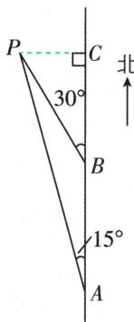

> [!success]- 必刷题
>
> > [!success] **【答案】** 有
>
> > [!note]- **【解析】**
> > 如图, 过点 P 作 $PC \perp AB$ . ∵ $\angle PBC = 30^{\circ}$ , $\angle PAB = 15^{\circ}$ , ∴ $\angle APB = 30^{\circ} - 15^{\circ} = 15^{\circ}$ , ∴ $\angle PAB = \angle APB$ , ∴ PB = AB. ∵ AB = $15 \times 2 = 30$ (海里), ∴ PB = 30 海里, ∴ PC = $\frac{1}{2}PB = 15$ 海里. ∵ 15 < 18, ∴ 有触礁的危险. 故答案为有.
> >
> > 
